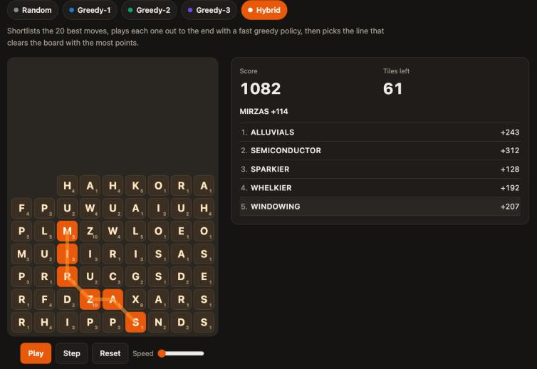
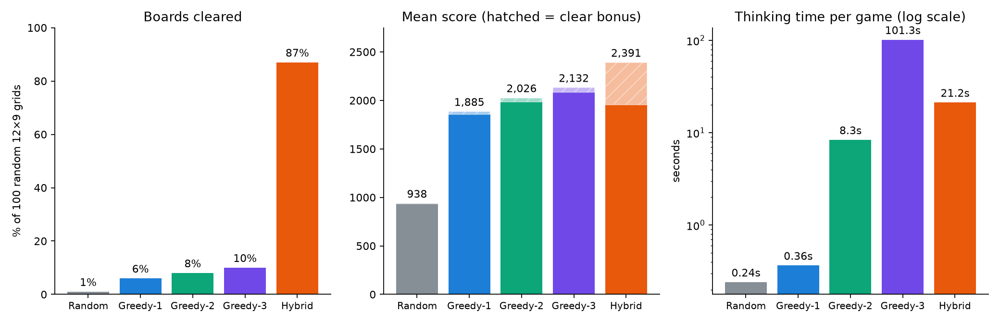

# Word Soup Solver

**Search algorithms that play a word puzzle. One of them clears 87% of boards, where plain greedy search clears 6%.**

Final-year project (MATH30000 Double Project), University of Manchester, 2025/26. Supervised by Dr Neil Morrison.

**[▶ Try the live demo](https://raudhahabas.github.io/word-soup-solver/)**: watch the five AI players solve the same board, or play it yourself and try to beat them.
· **[Read the full report (PDF, 124 pages)](report/Word_Soup_Analysis.pdf)**



---

## The problem

In *Word Soup* you trace words through a 12×9 grid of letters. Each word scores *length × sum of letter values*. Played letters disappear, and the remaining tiles fall **down and then right**. Clearing the whole board earns a **+500 bonus**.

The hard part is that every move changes the board. If you grab the highest-scoring word now, you can use up all the vowels and get stuck with tiles you can't play. So this is a sequential decision problem: a short-term gain can cost you later. The number of possible games is far too large to search exhaustively.

## What I built

| Player | Strategy |
|---|---|
| **Random** | Baseline: any playable word |
| **Greedy-1** | Highest-scoring word right now |
| **Greedy-2 / Greedy-3** | Look 2 or 3 moves ahead (beam of 20 words per step) and prefer lines that clear the board |
| **Hybrid** | Shortlist the top 20 moves, **play each one out to the end** with a greedy rollout, and choose the line that clears the board with the most points. The rollout looks deeper as the board empties (greedy-1, then 2, then 3). |

The foundation is a **trie-pruned depth-first search** that finds every word on the board. A fresh grid has about 2,500 playable words, out of a 170,000+ word dictionary. The search stops following a path as soon as its letters are no longer the start of a real word.

## Results

100 random 12×9 grids, same grids for every player:



| Player | Boards cleared | Mean score | Mean score excl. bonus | Time per game |
|---|---:|---:|---:|---:|
| Random | 1% | 938 | 933 | 0.24 s |
| Greedy-1 | 6% | 1,885 | 1,855 | 0.36 s |
| Greedy-2 | 8% | 2,026 | 1,986 | 8.3 s |
| Greedy-3 | 10% | 2,132 | 2,082 | 101 s |
| **Hybrid** | **87%** | **2,391** | 1,956 | 21 s |

What the results show:

- **Looking further ahead gives diminishing returns.** Greedy-3 thinks about 280× longer than Greedy-1, yet clears only 4 more boards in 100.
- **Rollouts beat deeper lookahead.** The Hybrid is 5× faster than Greedy-3 and clears 87% of boards instead of 10%. It scores fewer points from words than Greedy-3, but the clear bonus more than makes up for it.
- **The vowel ratio predicts success.** Boards with fewer than about 33% vowels are much harder to clear, whichever player you use. [More detail](figures/clear_rate_by_vowel_ratio.png).
- **Against a human expert:** on the 10 grids an expert played in the real app, the Hybrid averaged **2,242 vs the expert's 1,949** and outscored them on 8 of 10 grids. The expert cleared more boards, though (8 vs 6).

Full numbers: [`results/summary.csv`](results/summary.csv). Raw per-game data and notes: [`results/`](results/).

## Skills this project shows

- **Algorithms:** tries, depth-first search with pruning, beam search, n-ply lookahead, Monte Carlo-style rollouts
- **Experiment design:** controlled benchmarks (same seeded grids for every player), correctness checks on hand-built boards, runtime profiling
- **Data analysis:** pandas/matplotlib analysis of score, clear rate, runtime and board features
- **Software engineering:** a typed Python package with a CLI, a pytest suite, CI, and a JavaScript/HTML demo with no build step

## Quick start

Requires Python 3.10+. The solver itself has no dependencies.

```bash
git clone https://github.com/raudhahabas/word-soup-solver.git
cd word-soup-solver
python -m venv .venv && source .venv/bin/activate
pip install -e ".[dev,analysis]"

# Let the Hybrid solve one of the expert's grids
wordsoup solve data/expert_games/game_01_grid.txt --policy hybrid

# Benchmark a player on 20 random grids
wordsoup batch --policy greedy2 --runs 20 --seed 123 --csv greedy2.csv

# Play a game yourself in the terminal
wordsoup play --seed 7

# Tests
pytest
```

Use it as a library:

```python
from wordsoup import Trie, load_grid, play_game

trie = Trie.from_file("data/dictionaries/enable.txt")
result = play_game(load_grid("data/expert_games/game_01_grid.txt"), trie, "hybrid")
print(result.score, result.cleared, result.words)
```

## Repository layout

```
src/wordsoup/
  trie.py          prefix tree for word and prefix lookups
  board.py         word search (DFS), gravity, applying moves
  scoring.py       letter values, word score, clear bonus
  generate.py      random grids sampled by dictionary letter frequency
  players.py       Random, Greedy-1/2/3 and Hybrid, plus the game loop
  experiments.py   batch runner that writes per-game CSV/JSONL
  cli.py           `wordsoup` command
tests/             rules and player tests (pytest)
scripts/
  summarise_results.py    builds results/summary.csv and the results chart
  export_demo_replays.py  records every player's game for the web demo
data/
  dictionaries/    ENABLE word list (public domain)
  expert_games/    10 grids and move lists from an expert human player
results/           raw benchmark data behind the report
figures/           key charts
docs/              the web demo (GitHub Pages)
report/            the final report (PDF)
```

## Notes

- **Dictionary.** The report's experiments used a ~279,000-word list supplied by my supervisor, which I haven't redistributed. This repository uses the public-domain **ENABLE** list (~173,000 words) instead, so a rerun here gives similar but not identical numbers. To use your own list, pass `--dict path/to/words.txt` or set `WORDSOUP_DICT`.
- **Demo vs report.** The web demo replays games recorded with ENABLE (`scripts/export_demo_replays.py`). ENABLE has fewer words, so every player gets stuck more often there than in the report. The Hybrid clears 9 of the 16 demo grids.
- **Reproducibility.** Grids come from a seeded random generator. Python's string hashing changes word iteration order between runs, which can break ties differently. Set `PYTHONHASHSEED=0` for bit-for-bit repeatable games.
- **Code history.** This is a cleaned-up version of the research code. I checked it against the original scripts: on the same seeded grids, all five players choose the same words in the same order with identical scores and metrics.

## License

Code: [MIT](LICENSE). Report: © Siti Abas, all rights reserved.
